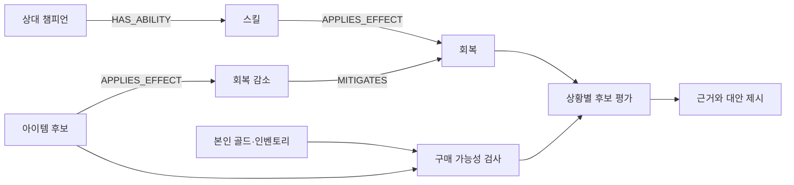

# LoL 챔피언·아이템 온톨로지와 추천 앱 조사

조사일: 2026-10-08. 현재 저장소는 빈 디렉터리였으며, 이번 작업은 조사와 설계 제안이다. 앱 구현, 인증 API 호출, 실제 게임 클라이언트 연결, 추천 성능 검증은 수행하지 않았다.

## 구현 후 외부 계약 재확인 (2026-10-08)

- KR realm은 `16.20.1`; [한국어 Champion JSON](https://ddragon.leagueoflegends.com/cdn/16.20.1/data/ko_KR/champion.json)은 173명, [Item JSON](https://ddragon.leagueoflegends.com/cdn/16.20.1/data/ko_KR/item.json)은 870개를 반환했다. 공개 브라우저 요청으로 정적 파일의 버전·개수를 확인했으며 앱 내부 로더의 브라우저 실행은 로컬 서버 권한 문제로 검증하지 못했다.
- [OP.GG MCP endpoint](https://mcp-api.op.gg/mcp)의 공개 `initialize`/`tools/list`는 성공했다. `lol_get_champion_analysis` 필수 인자는 `game_mode`, `champion`, `position`, `desired_output_fields`; `tier`는 선택 입력이다. `lol_list_lane_meta_champions`는 `desired_output_fields`가 필수이고 `position`만 선택한다. 두 도구 모두 `region`과 `patch` 입력은 없으며 `lang`은 지역을 뜻하지 않는다. 공식 README와 공개 tool schema를 대조했다: [OP.GG MCP README](https://github.com/opgginc/opgg-mcp/blob/main/README.md), [공식 소스](https://github.com/opgginc/opgg-mcp/blob/main/src/index.ts).
- 공개 조회 1회가 HTTP 200으로 성공했다: `champion=Ahri`, `game_mode=ranked`, `position=mid`, `tier=gold`, `lang=ko_KR`, 선택 필드 `data.summary.average_stats.{ban_rate,pick_rate,play,rank,tier,win_rate}`. 텍스트 응답은 `AverageStats(12510,0.51,0.09,0.03,3,31)` 구조였다. 공식 field type order에 따라 승률 51%, 픽률 9%, 밴률 3%, play 12,510, tier 3, rank 31로 표시한다. `play`를 별도 확인 없이 표본 수로 재명명하지 않는다.
- 따라서 Gold/position/ranked 통계 조회는 가능하지만 KR 지역과 특정 패치 범위를 응답에서 보장할 수 없다. 앱은 이 요약을 순위 점수에 반영하지 않고 출처 불명확성과 지역·패치 범위를 UI에 경고한다. 실제 앱 proxy 호출 및 브라우저 사용자 흐름은 현재 실행 환경에서 `listen EPERM`으로 미검증이다.

## 1. 판단

구현 가치가 있다. 제품의 중심을 **현재 조합과 제약에서 후보가 적합한 이유를 설명하는 추천 엔진**으로 잡는 것을 제안한다. 온톨로지는 데이터의 의미와 추론 경로를 정의하고, 통계 모델은 상황별 선호도·성과의 불확실성을 추정한다.

챔피언·아이템 목록을 그래프 DB에 넣는 것만으로는 부족하다. 스킬, 효과, 적용 조건, 조합 역할, 구매 경로, 패치, 관측 시점을 연결해야 한다. 최적 빌드나 카운터 관계를 영구적인 사실로 저장하지 않는다.

사용자는 조사 중 실시간성은 타협 가능하며 해당 추천 기능을 갖춘 앱을 만드는 것이 목적이라고 명확히 했다. 따라서 첫 제품은 **수동 상태 입력 → 밴·픽·다음 구매 아이템 추천 → 조건 변경 시 재계산**으로 정의한다. 자동 연결 없이도 세 기능을 모두 체험할 수 있게 한다. 아이템 상황 비교는 사전 시뮬레이션·사후 복기에서 먼저 검증하며, 실제 경기 중 사용은 아래 정책 경계를 따른다.

추천 엔진의 입력을 표준 상태 객체로 정의하면 수동 입력, 저장 경기 재생, 나중의 로컬 자동 수집이 같은 엔진을 사용한다. 갱신 주기를 늦추는 것은 구현 부담을 줄일 수 있지만 기능의 정책상 허용 여부를 바꾸는 보장은 아니다.

## 2. 데이터와 접근 경로

| 경로 | 활용 | 제약 |
|---|---|---|
| Data Dragon | 챔피언·스킬·아이템·조합식·이미지 | 정적 데이터, 패치 반영 지연 가능 |
| Match-v5 | 경기·타임라인 기반 학습 | 종료 경기 분석용, 실시간 스트림으로 취급하지 않음 |
| Spectator-v5 | 진행 경기의 기본 문맥 | 실시간 인벤토리 수집의 대체재로 설계하지 않음 |
| Live Client Data API | 게임 중 로컬 상태 | 네이티브 앱에서 접근 |
| League Client API, LCU | 밴픽 연동 후보 | 비공식 지원 영역, 호환성 보장 없음 |

출처: [LoL 공식 문서](https://developer.riotgames.com/docs/lol), [API 목록](https://developer.riotgames.com/apis).

로컬 게임 데이터 진입점은 `https://127.0.0.1:2999/liveclientdata/allgamedata`다. 클라우드 서버가 사용자의 localhost를 읽는 구조가 아니므로 자동 연동 제품에는 로컬 컴패니언을 둔다. [공식 Live Client 문서](https://developer.riotgames.com/docs/lol#game-client-api)

공식 샘플에는 `activePlayer.currentGold`, 본인 능력치·룬, `allPlayers`의 챔피언·아이템·레벨·스코어, 게임 상태·이벤트 구조가 있다. 샘플은 현재 실경기에서 모든 필드가 항상 최신·완전하다는 보장이 아니다. 적의 실제 현재 체력, 전체 능력치, 스킬 쿨다운, 비시야 위치를 완전하게 알 수 있다고 가정하지 않는다. 입력별로 `observed_at`, `source`, `visibility`, `missing_reason`을 관리하는 설계를 제안한다. [공식 샘플](https://static.developer.riotgames.com/docs/lol/liveclientdata_sample.json)

현재 조회한 KR realm은 champion/item 버전을 `16.20.1`로 표시한다. 이는 리소스 버전 확인 결과이며 실제 설치된 클라이언트와의 일치 검증은 아니다. [KR realm](https://ddragon.leagueoflegends.com/realms/kr.json)

### 인증과 수집 규모

Development key는 24시간마다 만료한다. Personal key는 개발자·작은 비공개 공동체용이며 공개 알파/베타 서비스 운영용이 아니다. 문서상 personal 제한은 초당 20회 및 2분당 100회다. 공개 API 기반 서비스는 Production key 경로를 준비해야 한다. 실제 수집기는 응답의 제한 헤더와 `Retry-After`에 따라 속도를 조절한다. [Developer Portal](https://developer.riotgames.com/docs/portal)

설계상 경기 N개마다 상세와 타임라인을 각각 수집하면 최소 약 2N회 요청이 필요하다. 목록 조회·재시도·다른 엔드포인트는 별도다. 100회/2분을 단순 적용하면 1만 경기의 두 응답 수집만 약 6.7시간의 이론적 하한이다. 실제 처리 시간이나 모든 엔드포인트에 동일 제한이 적용됨을 보장하는 계산은 아니다.

제안 수집 과정은 PUUID seed → 경기 ID 목록 → 중복 제거 → 상세/타임라인 저장 → 패치·큐·지역·역할별 집계다. Riot API가 가공된 전체 서버 카운터표·아이템 승률표를 제공한다고 가정하지 않는다. 역할·티어의 추정 시점과 추출 방법도 보존한다. 현재 티어를 과거 경기 당시 티어로 오인하지 않는다.

### LCU와 보조 데이터

커뮤니티 Swagger 기반 문서에는 `GET /lol-champ-select/v1/session`, `pickable-champion-ids`, `bannable-champion-ids` 등이 수록되어 있다. 실제 현재 클라이언트의 스키마·권한·노출 필드는 별도 검증해야 한다. 이번 조사에서는 호출하지 않았다. 커뮤니티 문서에 보이는 클라이언트 버전도 현재 설치본의 보장이 아니다. [LCU 문서 프로젝트](https://lcu.kebs.dev/)

CommunityDragon은 공식 Data Dragon을 보완할 클라이언트 데이터 조사 후보다. 커뮤니티가 운영하므로 공식 지원 API와 분리하고, 필요한 파일과 버전·출처를 명시한 어댑터로 제한하는 것을 제안한다. 이번 조사에서는 개별 챔피언 JSON 접근에 실패했으며 필드 완전성을 검증하지 못했다. [CommunityDragon](https://www.communitydragon.org/), [프로젝트 문서](https://github.com/CommunityDragon/Docs)

## 3. 정책상 제품 경계

Riot 일반 정책은 플레이어 대신 결정을 제거하는 도구를 제한하며, 여러 선택지를 통한 판단 지원을 설명한다. 제품 등록·감사, 변경 기능 검토, 익명 플레이어 식별 제한도 명시한다. [일반 정책](https://developer.riotgames.com/policies/general)

별도 지원 문서는 게임 중 플레이어 대신 결론을 내리는 앱을 문제 사례로 든다. 따라서 **공식 API로 데이터를 얻었다는 이유만으로 실시간 구매 추천 기능이 허용되는 것은 아니다.** 여러 후보를 보여준다는 이유만으로 자동 승인되는 것도 아니다. 실시간 아이템 기능의 허용 여부는 입력 필드, 갱신 조건, 표시 문구와 화면을 제시하여 확인해야 한다. 이는 정책 문구에 근거한 제품 설계 판단이며 Riot의 개별 승인 답변은 아니다. [Third Party Applications](https://support.riotgames.com/en-us/riot/events/third-party-applications)

2026-09-29 공지는 2026-10-06부터 미확인 외부 앱의 게임 메모리 접근을 차단하기 시작한다고 안내한다. 기존 승인 도구에는 2027년 4월까지 유예를 설명한다. 신규 앱은 그 유예 대상이라고 가정하지 않는다. 이 공지가 LCU 전체의 금지를 뜻한다고 단정할 근거는 없으며, LCU는 자체 지원 상태와 사용 범위를 따로 확인한다. [메모리 접근 변경 공지](https://support.riotgames.com/en-us/riot/performance/game-memory-access-removed-for-third-party-apps)

제안 제품 범위:

- 개발 우선: 밴픽 계획·후보 비교, 패치별 정적 빌드 탐색, 종료 경기 구매 복기.
- 별도 검증: 현재 밴픽에 대한 읽기 전용 자동 연동, 게임 중 상황 반영 아이템 후보 비교.
- 구현 제외: 자동 구매·자동 픽/밴, 숨겨진 플레이어 추적, 적 쿨다운 추적, 게임 메모리 접근.

수동 입력이나 로컬 개인용이라는 이유로 정책 검토가 면제된다고 해석하지 않는다. 정책 질의·신청은 이번 작업에서 전송하지 않았다.

## 4. 온톨로지 설계 제안

### 개체와 관계

| 개체 | 핵심 속성 또는 관계 |
|---|---|
| Champion | 안정적 ID, 표시명, `HAS_ABILITY`, 역할 적합성 |
| Ability | `DEALS_DAMAGE`, `APPLIES_EFFECT`, 사거리, 대상·발동 조건 |
| Item | `GRANTS_STAT`, `APPLIES_EFFECT`, `BUILDS_FROM`, 구매 제약 |
| Effect | 회복, 보호막, 회복 감소, 기절, 에어본, 이동, 둔화 등 |
| Role / CompositionNeed | 라인 역할, 이니시, 보호, 웨이브 정리, 지속 피해 등 |
| Patch / Queue | 버전·모드별 규칙과 유효 범위 |
| DraftState / GameSnapshot | 시점별 알려진 조합·밴·보유 아이템·골드 |
| Evidence / Estimate | 원문 출처, 검토 상태, 표본 수, 추정 방법, 불확실성 |

챔피언 정체성과 패치별 정의를 분리한다. 이름·번역을 조인 키로 쓰지 않고 원천 ID를 정규화한다. 상성·시너지는 `champion × role × opponent × patch × tier × queue` 등의 문맥이 붙은 추정치로 둔다.

`COUNTERS(A, B)` 하나보다 다음과 같은 추론이 낫다. 아래는 구조 예시이며 실제 패치 수치나 특정 아이템의 효과 검증 결과가 아니다.



회복 보유만으로 회복 감소 아이템을 최우선 추천해서는 안 된다. 적용 가능성, 효과 중복, 접촉 빈도, 내 챔피언과의 적합성, 핵심 아이템 완성 지연을 평가해야 한다. 사거리·광역성·팀원 역할처럼 수치화가 어려운 부분은 처음에는 검토된 정성 태그로 표현하고 신뢰 수준을 구분한다.

### 사실·해석·통계 분리

1. 원천 사실: ID, 가격, 조합식, 원문 설명, 버전.
2. 의미 주석: 효과 분류, 피해 패턴, 역할 기여, 발동 조건. 자동 추출 후 검토 대상.
3. 통계 추정: 특정 문맥의 선택 빈도·승률·상성 잔차. 표본 수와 추정 구간 포함.
4. 런타임 관측: 시점 t에 보였던 상태. 누락은 0 또는 부재로 해석하지 않음.
5. 추천 결과: 사용한 사실·주석·추정치와 규칙 버전을 참조하는 별도 객체.

각 주석에 `source_url`, `source_patch`, `extracted_at`, `review_status`, `conditions`를 둔다. LLM은 스킬 설명을 구조화하는 초안을 만들 수 있지만, 검토 전 주석을 실제 추천 규칙으로 승격하지 않는다. 기존 주석과 새 패치 원문이 달라지면 관련 규칙·추천을 재검토한다.

MVP 저장은 PostgreSQL의 명시적 개체·관계 테이블과 JSONB로 충분하다고 판단한다. 온톨로지 탐색·다중 관계 질의가 주 기능이면 그래프 DB를 추가하고, 표준 교환·논리 제약 검증이 필요하면 RDF/OWL·SHACL 도입을 검토한다. DB 종류보다 관계의 의미, 조건, 버전, 근거가 먼저다.

## 5. 아이템 추천 엔진 제안

핵심 타깃을 **다음 구매 행동과 그에 연결되는 완성 경로**로 정의한다. 최종 6개 아이템만 맞히는 모델과 구분한다.

입력: 본인 챔피언·역할·레벨, 현재 골드·아이템, 알려진 양 팀 조합, 시점, 패치·큐. 상대 아이템은 관측 가능성과 최신성이 검증된 것만 사용한다. 적 챔피언의 일반적 피해 성향을 이번 경기의 실제 피해 비중과 동일시하지 않는다.

제안 처리 순서:

1. 패치·모드·구매 제약과 조합식을 적용해 합법 후보를 만든다.
2. 보유 부품과 수량을 반영해 남은 비용을 계산한다. 부품 중복 차감, 되팔기, 구매 취소는 별도 처리한다.
3. 챔피언 적합성, 상대 대응 가치, 아군 역할 보완, 구매 타이밍, 경로 효율을 점수화한다.
4. 통계 근거가 충분한 경우 조건부 모델 점수를 결합한다.
5. 3개 정도의 후보에 이유·조건·포기하는 이점·불확실성을 붙인다.

```text
score(item, state)
  = champion_fit + threat_response + team_need
  + build_path_value + statistical_support
  - completion_delay - redundant_effect - uncertainty_penalty
```

위 식은 설계 가설이며 가중치나 효과가 검증된 모델이 아니다. 최종 점수를 승률로 표시하지 않는다. 초기에는 규칙과 템플릿 설명으로 만들고, 충분한 학습 데이터가 생기면 문맥 랭커를 비교한다. 매 상태 변경마다 LLM을 호출할 필요는 없다.

## 6. 픽 추천과 밴 추천 제안

픽 후보는 플레이 가능한 챔피언, 본인의 챔피언 풀·숙련, 역할, 현재 공개된 양 팀 픽, 조합 부족 요소로 평가한다. 챔피언 숙련도 점수만으로 실력을 대신하지 않고 본인 입력과 최근 역할별 경험을 함께 사용한다.

```text
pick_score = familiarity + role_fit + ally_synergy
           + matchup_value + composition_coverage
           - blind_pick_risk - uncertainty
```

아군의 이니시·보호·지속 피해 부족처럼 어떤 역할을 보완하는지 보여준다. 아직 공개되지 않은 상대 픽은 확정값이 아니라 가능한 후보 분포 또는 미지수다.

밴은 별도 목적함수가 필요하다. 밴하는 시점에 확보된 정보만 사용하여 상대가 가져갈 확률과 우리 챔피언 풀에 주는 손실을 결합하고, 아군이 해당 챔피언을 쓰려는 가치도 반영한다.

```text
ban_score = expected_opponent_pick_probability × expected_harm_to_our_pool
          - value_if_available_to_our_team
```

솔로랭크와 대회 드래프트는 별도 규칙 프로필로 구현한다. 각 프로필에서 밴/픽 순서, 공개 정보, 확정/선호 픽, 스왑을 정의한다. 실제 밴 타이밍에 알 수 없었던 최종 10명 조합을 입력으로 쓰는 학습·평가를 금지한다.

MCTS나 자기대국은 처음부터 필요하지 않다. 1단계 후보 랭커를 검증한 다음, 명시적인 대회 드래프트 규칙과 가치 모델이 있을 때 탐색을 추가한다.

## 7. 통계·평가의 함정과 실험

아이템 구매자의 승률이 높다는 사실은 아이템을 사면 승률이 그만큼 오른다는 뜻이 아니다. 이미 유리한 플레이어가 비싼 아이템을 먼저 완성하는 선택 편향이 있다. 챔피언 상성도 숙련도·역할·티어·패치에 영향을 받는다.

학습용 상태는 t 이전 정보로만 구성한다. 최종 골드·최종 인벤토리·경기 전체 피해량을 당시 추천 입력으로 넣지 않는다. 타임라인을 재구성할 때 구매·판매·취소 이벤트와 관측 간격을 확인한다. 타임라인 재구성 상태와 Live API 상태가 동일하다고 가정하지 않고 공통 필드로 먼저 평가한다. 실제 필드 계약은 인증된 표본 응답으로 검증해야 한다.

첫 비교 실험 제안:

| 실험군 | 의미 |
|---|---|
| A | 패치·역할별 인기 아이템/챔피언 기준선 |
| B | 온톨로지와 검토된 규칙만 사용 |
| C | 통계·문맥 랭커만 사용 |
| D | 온톨로지 제약 + 통계 랭커 + 근거 설명 |

동일 입력·후보 집합·평가 시점에서 비교하고, D가 C보다 무엇을 개선하는지 측정한다. 현재의 연구 가설은 추천 유효성, 저표본 상황의 안정성, 설명의 정확성 개선이다. 승률 향상은 미검증이다.

제안 지표:

- 제약 위반율: 불가능한 구매, 이미 밴된 픽, 다른 패치 아이템 추천. 출시 검증셋 목표 0건.
- next-item/pick Recall@K·NDCG: 관측된 선택 재현 지표이며 최적성 지표는 아님.
- 전문가 비교: 후보의 적합성, 놓친 대안, 설명과 실제 근거의 일치.
- 확률 예측을 도입할 때 calibration·Brier score와 표본별 신뢰구간.
- 동일 상황 재생 시 지연·추천 진동·데이터 누락 대응.
- 패치 시간 분할, 경기 단위 분리, 희귀 조합·초보 숙련·패치 직후 별도 평가.

동일 경기에서 나온 여러 구매 시점은 독립 표본처럼 신뢰구간을 계산하지 않고 경기 단위로 묶는다. 온라인 승률 평가에는 표본 설계·사용자 선택 편향·정책상 실험 허용 범위 검토가 별도로 필요하다.

## 8. 구현 순서 제안

### 단계 1 — 데이터와 의미 검증

소환사의 협곡 솔로랭크를 임시 범위로 두고 정적 데이터 스냅샷·ID 매핑·패치 갱신 검증을 만든다. 의미 주석은 예를 들어 20개 챔피언·50개 아이템에서 검증한 뒤 확장한다. 범위 밖 개체는 미지원으로 표시하고 일반화된 사실처럼 채우지 않는다.

완료 기준: 가격·조합식·효과별 출처 추적, 패치 혼합 탐지, 검토된 의미 관계, 최소 한 가지 설명 경로 재현.

### 단계 2 — 수동 입력 밴픽·빌드 비교

본인 역할·풀·공개 조합을 선택하면 후보와 근거가 갱신되는 웹 도구를 만든다. 아이템은 게임 시작 전 상황 비교 및 종료 경기 복기에 사용한다. 초기 데이터가 적으면 수동 규칙과 통계 부족 표시로 동작한다.

첫 앱의 화면은 세 개로 제안한다.

| 화면 | 사용자가 바꾸는 입력 | 출력 |
|---|---|---|
| 밴·픽 플래너 | 본인 역할·챔피언 풀, 현재 공개된 아군/적군 픽·밴, 드래프트 단계 | 밴 또는 픽 후보 3개, 조합 기여·위험·숙련 적합성 |
| 아이템 상황 비교 | 본인 챔피언·골드·보유 아이템, 알려진 조합·아이템, 경기 시점 | 다음 구매 후보 3개, 완성 경로, 선택 이유와 기회비용 |
| 근거 보기 | 추천 후보 선택 | 사용한 효과·관계·규칙·패치·출처, 통계 유무 |

예시 수용 기준: 다른 조건을 고정하고 골드만 낮추면 구매 가능한 부품으로 후보가 바뀌고, 조합의 회복 위협을 바꾸면 관련 후보 점수의 변화 이유를 표시한다. 밴/선택 완료 챔피언은 픽 후보에서 사라진다. 이런 동작 검증과 실제 전략적 유용성 평가는 구분한다.

완료 기준: 고정 사례셋에서 기준선 대비 평가, 후보 유효성, 설명 출처, 누락·미지원 입력의 처리.

### 단계 3 — 클라이언트 연결 검증

실제 대상 OS에서 LCU와 Live Client 스키마·필드 가시성·연결 수명주기를 확인한다. 읽기 전용 어댑터, 연결 종료·재접속, 버전 변경 처리를 검증한다. 로컬 인증 정보는 기기 밖으로 보내지 않는다. 웹 UI와 로컬 프로세스 사이에는 요청 인증과 허용 origin 검사를 둔다.

완료 기준: 연결·종료·재접속 사례 재현, 수동 입력 fallback, 필드별 관측 계약, Riot 검토에 제시할 사용 화면과 엔드포인트 목록.

### 단계 4 — 허용 범위 내 실시간 기능

Riot에 확인된 범위로만 게임 중 표시 기능을 활성화한다. 실시간 아이템 추천이 허용되지 않으면 같은 엔진을 사전 계획과 사후 복기에 사용한다. 정책 검토 중에도 앞 단계의 데이터·온톨로지·오프라인 평가는 진행할 수 있다.

초기 구조는 정적 ETL → 버전 있는 지식 저장소 → 결정론적 후보 생성 → 규칙/통계 랭커 → 템플릿 설명 → UI로 제안한다. 로컬 어댑터는 입력 모듈이며 추천 엔진과 분리한다. 서버는 비밀 API 키와 경기 집계를 담당한다. LLM을 핵심 실시간 경로에 두지 않는다.

## 9. 직접 관련된 선행 연구

- [TTIR, Interpretable Contextual Team-aware Item Recommendation (2020)](https://arxiv.org/abs/2007.15236): 팀 문맥을 반영하는 아이템 추천 연구. 팀 조합을 입력으로 활용하는 기준선 후보다. 저자들은 attention 시각화를 설명 수단으로 제시하지만, 본 프로젝트에서는 attention을 효과 메커니즘이나 인과적 설명의 증거로 간주하지 않는다.
- [DraftRec (2022)](https://arxiv.org/abs/2204.12750): 개인 챔피언 선호와 팀 상호작용을 함께 모델링하며 LoL 및 Dota2로 평가했다. 개인화 밴픽 랭커 비교 후보다. 논문의 결과는 현재 패치·실시간 연동·정책 허용을 보장하지 않는다.
- [JueWuDraft (2020)](https://arxiv.org/abs/2012.10171): 신경망과 MCTS를 결합한 다중 라운드 드래프트 연구이며 실험 대상은 Honor of Kings다. 대회 드래프트 확장 아이디어로 참고하되 LoL 성능 근거로 사용하지 않는다.

이 프로젝트의 검증 가능한 차별화 가설은 **버전이 있는 효과·조건 그래프가 통계 추천의 오류를 줄이고, 상황별 선택 이유를 더 정확하게 설명하는가**다. 단순히 온톨로지를 추가했다는 사실 자체를 추천 성능 향상으로 주장하지 않는다.

## 10. 확인하지 못한 사항

- 현재 클라이언트의 실제 LCU·Live 응답, 안개/관측에 따른 필드 갱신.
- 인증 Match-v5 상세·타임라인 응답과 현재 엔드포인트별 호출 제한.
- 최신 champion/item JSON 전체 내용: 웹 도구 접근 실패. 문서와 KR realm을 확인했을 뿐 전체 다운로드·파싱은 하지 않았다.
- 추천 품질, 지연, 비용, 패치별 주석 유지보수량.
- 이 앱의 구체적 실시간 추천 화면에 대한 Riot 승인 여부.

공식 문서 일부 예시는 오래된 설명일 수 있으므로 해당 페이지의 예시 수치를 현재 아이템 효과로 복사하지 않는다. 구현 시작 시 버전 고정 원본과 실제 표본 응답 검증이 첫 작업이다.
